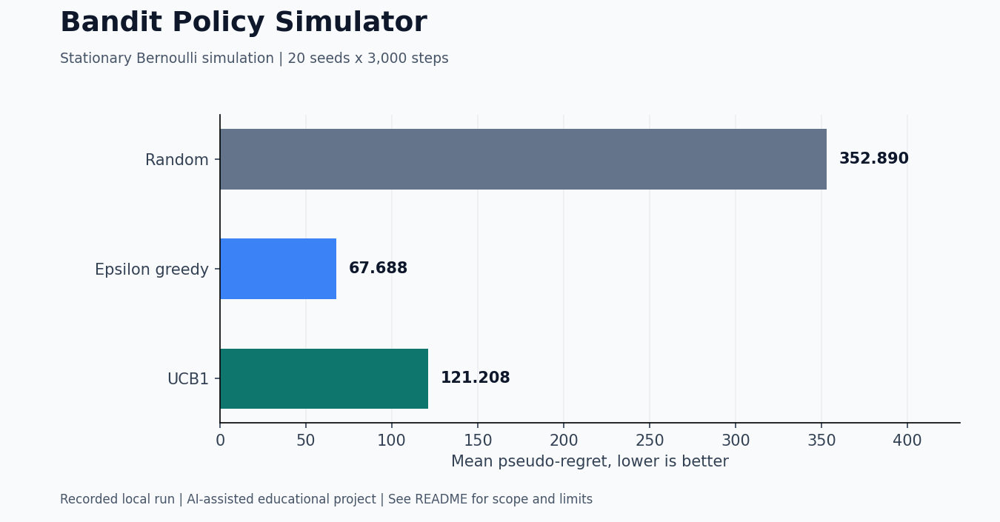

# Bandit Policy Simulator

[](https://github.com/MoustafaMZaalouk/bandit-policy-simulator/blob/main/.github/workflows/checks.yml)

*Live workflow status, not a production-readiness or model-quality rating.*

Compare random, epsilon-greedy and UCB1 policies across repeated seeded Bernoulli simulations.

A small educational project prepared with AI assistance for Moustafa Zaalouk's portfolio. This is new demonstration code, not a claim about past employment, research, clients or production deployment. It does not reuse another person's project under a different name.

## Run it

Use Python 3.10 or newer. The recorded local run used Python 3.10.12. A virtual environment is recommended.

```bash
python -m venv .venv
source .venv/bin/activate
pip install -r requirements.txt
python demo.py
python -m unittest -v
```

On Windows use `.venv\Scripts\activate` instead. The first command runs the full experiment and writes `results.json`. The second runs four checks. No API keys, paid services or internet data downloads are needed after dependency installation.

## Recorded results



These values are generated from `results.json`, not estimated or copied. Rerun the code to check them. Minor numerical differences may occur across platforms. Full per-example or per-fold details, where applicable, are in the JSON file.

| Measure | Local result |
| --- | ---: |
| Epsilon greedy: mean pseudo regret | 67.688500 |
| Epsilon greedy: mean reward | 1077.200000 |
| Epsilon greedy: regret standard deviation | 47.294177 |
| Epsilon greedy: reward standard deviation | 65.873563 |
| Random: mean pseudo regret | 352.889500 |
| Random: mean reward | 783.550000 |
| Random: regret standard deviation | 5.335680 |
| Random: reward standard deviation | 22.307598 |
| UCB1: mean pseudo regret | 121.208000 |
| UCB1: mean reward | 1024.650000 |
| UCB1: regret standard deviation | 17.507468 |
| UCB1: reward standard deviation | 43.190246 |
| Steps per seed | 3000 |

`verification.txt` records the local test run. The included GitHub Actions workflow is a reproducible check, not a claim that remote CI has already passed.

## How to read the code

1. `demo.py`: data construction/loading, split, model, evaluation and output.
2. `test_demo.py`: output consistency and three experiment-specific checks.
3. `results.json`: the actual captured local results.
4. `requirements.txt`: exact versions used locally.

## Publishing and CI

The initial source is stored as a checksummed ZIP inside the workflow so GitHub can restore exact filenames and the chart without a manual multi-file upload. On its first run it unpacks this original AI-assisted source, tests it, runs the experiment and commits the initialized files as `github-actions[bot]`. Later runs test the actual checked-out source; they do not overwrite it from the bundle. This automation history is not a claim of manual authorship or review.

## Data and attribution

Procedurally generated synthetic data. No personal data or external downloads.

The experiment uses NumPy, SciPy and scikit-learn rather than claiming to implement their estimators from scratch. Their licenses and dataset terms remain separate from this repository's MIT license. No upstream code, author name or license was removed.

## What this does not prove

A stationary simulated environment with known Bernoulli reward rates. Pseudo-regret is an oracle diagnostic using those rates, not observed loss. This is online simulation, not offline policy evaluation or a real A/B test. The fixed epsilon and UCB coefficient are not tuned. No revenue or causal lift claims.

## شرح بالمصري

الفكرة: نجرب كذا اختيار ونتعلم مين أحسن من المكافآت. نقارن الاختيار العشوائي بـepsilon-greedy وUCB. كل ده محاكاة، مش تجربة حقيقية على مستخدمين.

لما تشرح المشروع: قول مصدر الداتا، اتقسمت إزاي، إيه الـbaseline، بنقيس بإيه، وإيه حدود النتيجة. ما تقولش إنه شغال في production أو نتيجة على داتا حقيقية لو التجربة صناعية.

## Next experiment

Replace the demonstration data with an appropriately licensed dataset, define an independent evaluation protocol before tuning, and report failures as well as successes. Keep private data and credentials out of commits.
